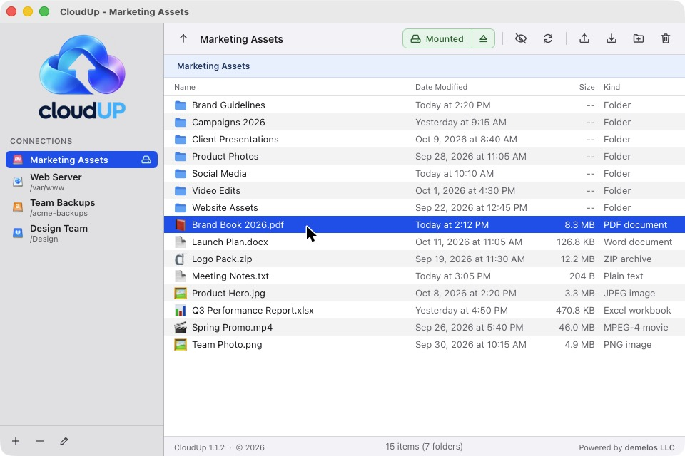
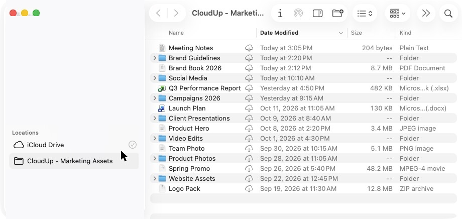
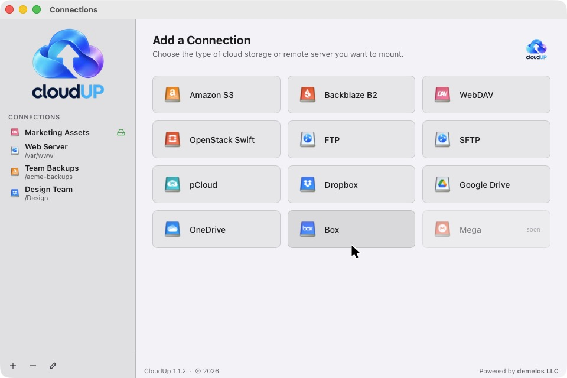
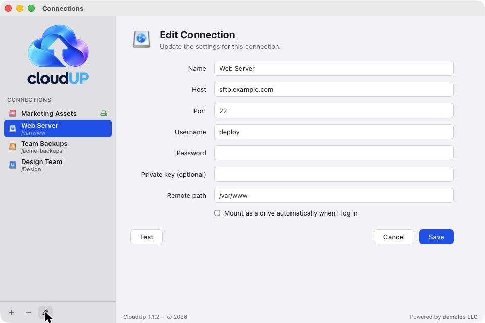

# CloudUp

CloudUp is a small desktop app (Tauri 2, Rust backend + plain-JS frontend) that lets you connect to cloud storage and browse, edit, copy and drag files in and out — and mount it in Finder's sidebar as a Location (see *Finder integration*).

The built-in browser lists, previews and edits remote files directly; mounting in Finder is optional.



| Finder sidebar | Add a connection | Edit a connection |
|---|---|---|
|  |  |  |

## Supported providers

| Provider | Status | Auth |
|---|---|---|
| Amazon S3 (and any S3-compatible endpoint) | ✅ Working | Access key + secret key |
| Backblaze B2 | ✅ Working | App key ID + app key (mapped onto the S3 backend with B2 endpoint/region defaults) |
| WebDAV | ✅ Working | User + password |
| OpenStack Swift | ✅ Working | Auth URL + user + password (v3 token auth) |
| FTP | ✅ Working | Host, user, password (passive mode) |
| pCloud | ✅ Implemented, not yet verified on a live account | Email + password (API host `api.pcloud.com`, EU accounts `eapi.pcloud.com`; CloudUp switches automatically) |
| Dropbox | ✅ Implemented, not yet verified on a live account | OAuth2 (user-supplied `client_id`) |
| Google Drive | ✅ Implemented, not yet verified on a live account | OAuth2 (user-supplied `client_id`); deletes go to the Drive trash |
| OneDrive | ✅ Implemented, not yet verified on a live account | OAuth2 (user-supplied `client_id`) |
| Box | ✅ Implemented, not yet verified on a live account | OAuth2 (user-supplied `client_id`) |
| SFTP | ✅ Working | User + password, or a private key (PEM pasted as the secret, or a key file path such as `~/.ssh/id_ed25519`) — `libssh2`/OpenSSL are built into the app. Host keys are checked against `~/.ssh/known_hosts` and CloudUp's own `known_hosts` (trusted on first use, refused if they change) |
| MEGA | ⚠️ Hidden in the app | Email + password, via an external `mega` command-line client (see below) |

Passwords and OAuth tokens are kept in the macOS keychain. Connection settings are in `~/Library/Application Support/net.cloudup.app/config.json` (readable only by you). Downloads are marked as downloaded from the internet (quarantine), so Gatekeeper checks anything you open.

### MEGA (experimental)

MEGA encrypts files client-side with a proprietary scheme, so CloudUp does not talk to MEGA directly. Instead it shells out to a command-line client named `mega` that must be on your `PATH`, invoked as:

```sh
mega --username <email> --password <password> --config <dir> ls --long mega://<path>
mega ... get mega://<path> <local-file>
mega ... put mega://<path> <local-file>
mega ... mkdir | rm | rmdir mega://<path>
```

This interface has **not yet been verified** against an existing tool — it does not match MEGA's official MEGAcmd (`mega-ls`, `mega-get`, …) or megatools (`megatools ls`, …) out of the box. Until the backend is adapted to one of them (or you provide a `mega` wrapper script with this interface), MEGA connections will report an error. Every MEGA operation surfaces a clear error message if `mega` is missing.

## Testing against live accounts

`cargo test` runs the unit tests. The live round-trip tests in `src-tauri/tests/cloud.rs` create, read, list and delete a throwaway `cloudup-test-*` folder on a real account; each one skips unless its environment variables are set:

```sh
CM_TEST_SFTP_HOST=… CM_TEST_SFTP_USER=… CM_TEST_SFTP_SECRET=… \
  cargo test --test cloud -- --nocapture
```

Variables: `CM_TEST_S3_ENDPOINT/REGION/KEY/SECRET/BUCKET`, `CM_TEST_SFTP_HOST/PORT/USER/SECRET/ROOT`, `CM_TEST_MEGA_EMAIL/PASSWORD`.

## OAuth setup (Dropbox, Google Drive, OneDrive, Box)

These four providers authenticate with OAuth2 PKCE. You must register your own app with the provider and paste the resulting `client_id` into the connection form:

- **Dropbox** — [Dropbox app console](https://www.dropbox.com/developers/apps): create an *Dropbox API* app and paste its App key (the `client_id`).
- **Google Drive** — [Google Cloud Console](https://console.cloud.google.com/apis/credentials): create an *OAuth client ID* of type *Desktop* and paste the Client ID.
- **OneDrive** — [Azure portal → App registrations](https://portal.azure.com): register a *mobile & desktop* app and paste the Application (client) ID.
- **Box** — [Box developer portal](https://developer.box.com/v3.0/apps): create an app and paste the client ID.

During "Connect", CloudUp opens the provider's consent page in your browser with a loopback redirect (`http://127.0.0.1:<port>`). You do **not** need to run a web server or register a custom redirect — when you approve, the provider hands the code back to the local app, which exchanges it for a token.

## Build & run

Prerequisites: Rust (1.77+), Node.js, and the Tauri CLI via npm.

```sh
npm install
npx tauri dev      # run the app in development
```

For a release build: `sh scripts/release.sh` (signed and notarized; see below).

### Finder integration (mounting)

**Mount** puts a connection in Finder's sidebar under *Locations* as **CloudUp - <name>** — one click to the files, like iCloud Drive or OneDrive. Files download when opened (cloud icon until then) and upload when saved; new folders, rename, move and delete all go to the cloud. The first time, macOS asks you to **Enable** CloudUp in Finder (one-time).

How it works:

- `src-tauri/fileprovider/Extension.swift` is a File Provider extension (`NSFileProviderReplicatedExtension`), built by `scripts/build-fileprovider.sh` during `tauri build` and bundled at `Contents/PlugIns/CloudUpFiles.appex` (sandboxed, app group `8V6DT796JV.net.cloudup`).
- For each mounted connection CloudUp runs a small WebDAV server on `127.0.0.1` (`src-tauri/src/mount/davfs.rs`) over the same backends the in-app browser uses, publishes its address in the app-group container (`drives.json`), and registers a File Provider domain (`src-tauri/src/mount/finder.rs`). The extension is a WebDAV client of that server.
- Locations persist across restarts. If one is opened while CloudUp isn't running, the extension starts CloudUp in the background. "Mount automatically when I log in" adds a login item.
- Changes made elsewhere show up within ~45 s (CloudUp signals Finder to re-check the folders it has shown).

No macFUSE or other system extension is needed. Requires macOS 13+.

## macOS signing & notarization

- **Signing** is configured: `tauri.conf.json → bundle.macOS.signingIdentity` is `"Developer ID Application"`, so `npx tauri build` signs with the Developer ID certificate in your keychain.
- **Notarization:** build releases with `APPLE_API_ISSUER=<issuer-id> sh scripts/release.sh "notes"`. It notarizes and staples the app (via the App Store Connect team API key `Z3PB956L6L` in `~/.appstoreconnect/private_keys/`), then notarizes and staples the DMG, checks both with `spctl`, and puts the DMG, updater bundle, `.sig` and `latest.json` in `dist/`. A plain `npx tauri build` is signed but **not** notarized, and Gatekeeper blocks it on other Macs.
- The Finder extension is signed by `scripts/build-fileprovider.sh` (with its own sandbox entitlements and a secure timestamp, which notarization requires) before the bundler signs the app; `APPLE_SIGNING_IDENTITY` overrides the identity.

## Repository layout

```
src/           plain-JS frontend (served by scripts/serve.js)
scripts/       dev server
src-tauri/     Rust/Tauri backend
  src/config.rs   connection model + persistence
  src/backend.rs  Backend enum dispatch
  src/s3.rs …     per-provider backends
  src/oauth.rs    shared OAuth2 PKCE + token refresh
  src/mount/      Finder Locations: local WebDAV server + File Provider domains
  src/dragout.rs  drag files out to Finder (file promises)
  fileprovider/   the Finder extension (Swift)
  src/commands.rs Tauri IPC surface
```
